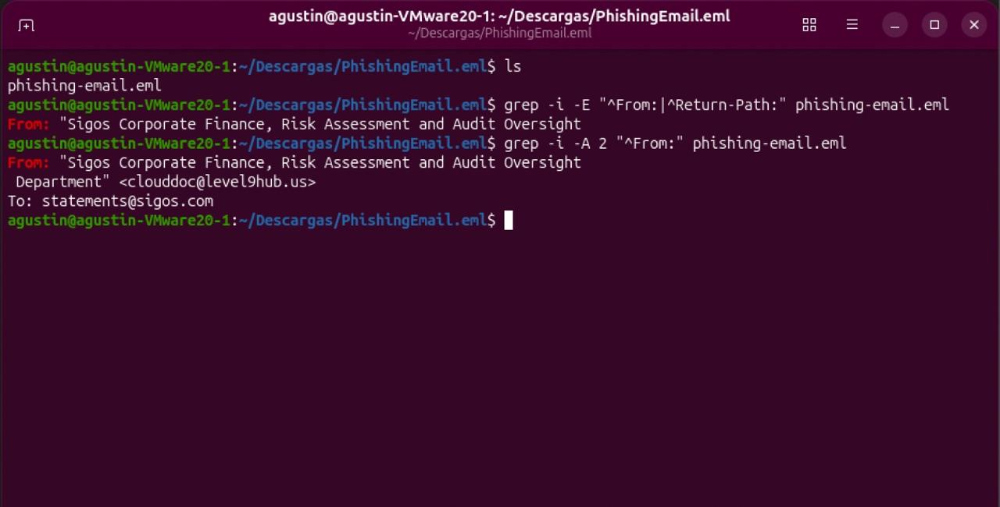
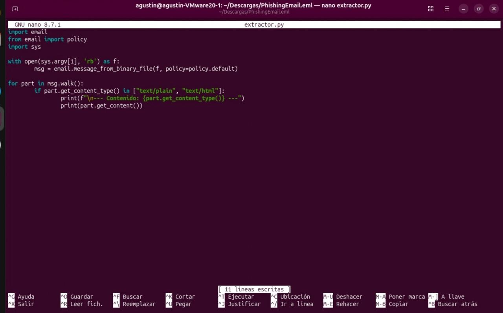
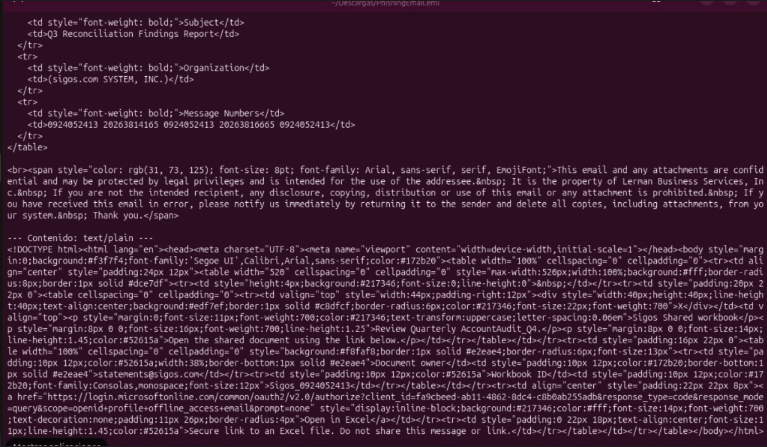

#
# Phishing Analysis & Triage - Illicit Consent Grant Attack

**Author:** Agustín Cassano  
**Date:** October 2026

---

## Executive Summary
This report details the analysis of a targeted phishing email (Spearphishing) designed to bypass traditional credential harvesting by leveraging OAuth application consent. The attacker successfully spoofed an internal Finance & Audit department to induce urgency. The malicious payload was disguised as a link to an Excel report that, when clicked, directs to legitimate Microsoft login infrastructure to grant permissions to a malicious enterprise application (Illicit Consent Grant).

An automated Python extraction script was developed to safely decode the body content and extract the underlying IOCs without risking execution.

---
## Lab Setup & Methodology
To ensure a safe analysis environment and prevent accidental host compromise, the following precautions and tools were utilized:
- Isolation Environment: A Linux Virtual Machine was deployed using VMware Fusion.
- Strict Isolation: Shared folders, drag-and-drop, and the bidirectional clipboard between the VM and the host were completely disabled.
- Sample Acquisition: The malicious `.eml` sample was securely sourced and downloaded from the public malware sandbox platform, Any.Run.

---


## MITRE ATT&CK® Mapping
* *T1566.002 - Phishing:* Spearphishing Link (Tactic: Initial Access).  
Description: The initial entry vector. The attacker utilized a highly targeted email impersonating the internal finance department, containing a malicious link disguised as an Excel report.
* *T1204.001 - User Execution:* Malicious Link (Tactic: Execution).  
Description: The attack entirely depends on user interaction. The victim must actively click the fake "Open in Excel" link to initiate the OAuth authorization flow.
* *T1528 - Steal Application Access Token:* (Tactic: Credential Access).  
Description: The core objective of the attack. By tricking the user into granting permissions (consent) to the malicious application (client_id=fa9cbeed...), the attacker obtains an OAuth access token. This token enables interaction with Microsoft APIs (such as the Graph API) on behalf of the user, completely bypassing the need for their actual password.
* *T1098.003 - Account Manipulation:* Additional Cloud Roles (Tactic: Persistence)  
Description: Once the malicious application is approved within the victim's Azure AD tenant, the attacker maintains persistent access to the cloud resources (e.g., emails, SharePoint, or OneDrive files) authorized by that token. This persistent access remains active even if the user changes their password or if Multi-Factor Authentication (MFA) is required.

---

## Indicators of Compromise (IOCs)

| Indicator Type | Value                                           | Notes                                            |
|---------------|-------------------------------------------------|--------------------------------------------------|
|Sender Domain  | `level9hub.us`                                  | Spoofed as "Sigos Corporate Finance"              |
|Sender Email   | `clouddoc@level9hub.us`                         | Hidden in the Return-Path header                  |
|Target Email   | `statements@sigos.com`                          | sigos.com SYSTEM, INC.                            |
|Malicious URL  | `hxxps://login.microsoftonline.com/common/...`  | Directs to legitimate Microsoft ADFS for app consent|
<Azure Client ID| `fa9cbeed-ab11-4862-8dc4-c8b0ab255adb`         | The unique identifier of the attacker's azure app  |

---

## Analysis Walkthrough

### 1. Header Analysis & Email Authentication (Spoofing Detection)
The attacker used display-name spoofing to appear internal.
Analyzing the headers revealed a discrepancy between the `From` and `Return-Path` fields.


```bash
Return-Path: <clouddoc@level9hub.us>
From: "Sigos Corporate Finance, Risk Assessment and Audit Oversight Department" <clouddoc@level9hub.us>
```
Defense Evasion (SPF/DKIM/DMARC):  
By using an external, attacker-controlled domain (level9hub.us) rather than attempting to spoof the actual corporate domain (sigos.com), the attacker likely ensured that the email successfully passed SPF, DKIM, and DMARC authentication checks. This is a common evasion technique: threat actors register new, look-alike or neutral domains and configure valid DNS security records. Consequently, the Secure Email Gateway (SEG) processes the email as a "legitimate" external communication, and the attacker relies entirely on the spoofed Display Name to deceive the end-user.
### 2. Payload Extraction (Automation)
To safely analyze the email's body and bypass any Base64/HTML obfuscation, a Python script (`extractor.py`) was developed to parse the `.eml` file and extract the plain-text/HTML content.

Inside the HTML body, the "Open in Excel" button contained the OAuth phishing link:
```html
<a href="https://login.microsoftonline.com/common/oauth2/v2.0/authorize?client_id=fa9cbeed-ab11-4862-8dc4-c8b0ab255adb...">Open in Excel</a>
```

---

## Recommended Remediation
1. **Threat Hunting (SIEM / Audit Logs)**  
Before deleting the application, it is critical to determine if any users actually clicked the link and granted consent.
    * Action: Query the Microsoft 365 Unified Audit Logs (UAL) or your SIEM (e.g., Microsoft Sentinel) for the Consent to application operation targeting the attacker's Client ID.
    * Example KQL Query (Microsoft Sentinel):
    ```kql
    AuditLogs
    | where OperationName == "Consent to application"
    | where TargetResources has "fa9cbeed-ab11-4862-8dc4-c8b0ab255adb"
    | project TimeGenerated, InitiatedBy = Identity, TargetResources
    ```  
    *Note: This query will identify exactly which user accounts have been compromised and require immediate credential rotation and token revocation.*  
    
2. **Azure AD Remediation (Eradication & Recovery)**  
Once the scope of the compromise is identified, proceed to neutralize the threat.  
	- Revoke Access: Navigate to Azure Active Directory > Enterprise Applications. Search for the malicious Client ID (fa9cbeed-ab11-4862-8dc4-c8b0ab255adb), review the granted permissions, and completely delete the application from the tenant. This instantly invalidates the attacker's OAuth access tokens.
	- Proactive Hardening: To mitigate future Illicit Consent Grant attacks, navigate to Consent and permissions in Azure AD and configure the tenant to “Do not allow user consent” or mandate “Admin consent requests” for all unverified third-party applications.
3. **Email Security (SEG)**  
- Block Indicators: Block the sender domain level9hub.us at the Secure Email Gateway (SEG).  
- Security Awareness: Notify the Finance department about this specific spearphishing campaign, emphasizing that attackers can leverage legitimate Microsoft infrastructure (login.microsoftonline.com) to execute consent phishing attacks without using fake login pages.

---

## Appendix: Automation Script
```python
# extractor.py
import email
from email import policy
import sys

with open(sys.argv[1], 'rb') as f:
    msg = email.message_from_binary_file(f, policy=policy.default)

for part in msg.walk():
    if part.get_content_type() in ["text/plain", "text/html"]:
        print(f"\n--- Contenido: {part.get_content_type()} ---")
        print(part.get_content())
```
